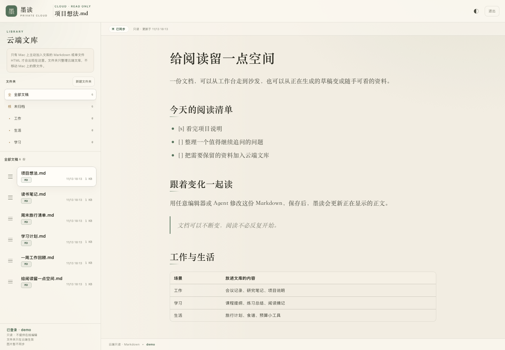
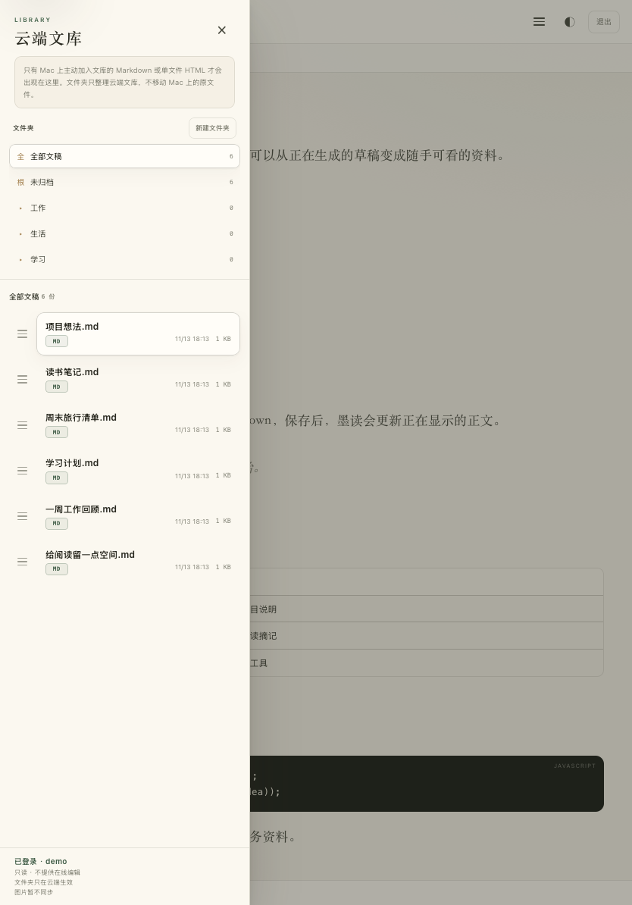

<p align="center"></p>
<h1 align="center">墨读 · Modu</h1>
<p align="center"><strong>让 AI 写出的文档，变成你愿意读、随时能用的内容。</strong></p>
<p align="center">Mac 实时 Markdown 阅读器 · HTML 小工具 · 自托管云文库 · iPad / iPhone</p>
<p align="center"><a href="https://github.com/0x7854/modu/releases">下载</a> · <a href="#快速开始">快速开始</a> · <a href="cloud/DEPLOY.md">自部署</a> · <a href="docs/SHARE.md">分享介绍</a> · <a href="LICENSE">ISC License</a></p>

Modu is a live Markdown and HTML reader for macOS, with an optional self-hosted library for iPad and iPhone.



## 为什么做墨读

Agent 写方案、整理会议、生成报告越来越快，但读这些内容仍然有不少小麻烦：文件一直在更新，需要反复刷新；在 Mac 上写完，拿起 iPad 又找不到；生成一个 HTML 计算器，手机上却不方便打开。

墨读把这几件事连起来：**Mac 上打开本地文件就能持续阅读；主动加入云文库后，换到 iPad 或 iPhone 接着看。** 如果文件是 HTML，还能直接使用其中的按钮、计算器和交互页面。

它本身不调用大模型。只要工具能保存 `.md` 或单文件 `.html`，就可以配合墨读使用，无需绑定某个 Agent。

## 它解决什么问题

| 你遇到的情况 | 墨读怎么做 | 适合的场景 |
| --- | --- | --- |
| Agent 正在改 MD，反复关闭重开很烦 | 监听本地文件变化，自动更新正文并尽量保留阅读位置 | 边生成边看方案、研究报告、项目文档 |
| MD 能看，但长文阅读不舒服 | 目录、查找、明暗主题、字号和版心设置 | 深度阅读、审阅、学习笔记 |
| Mac 上的文档想在 iPad / iPhone 看 | 主动加入的文档上传到自己的云文库，文件变化后自动同步 | 通勤阅读、沙发上看报告、会前准备 |
| Agent 生成了 HTML 小工具，不方便在手机使用 | 在隔离的页面中展示单文件 HTML，支持页面自己的交互 | 计算器、清单、可交互说明和演示 |
| 文件多了找不到 | 云端文件夹和子文件夹，两端共用分类 | 工作、生活、待读、项目资料 |
| iPad 上不想逐个点菜单整理 | 从文档前面的三道杠拖到文件夹；轻点也能选择位置 | 触屏归档和整理 |

## 能做什么

### Mac：本地打开，即时阅读

- 独立 macOS 应用，有自己的图标，可留在 Dock。
- 双击 Markdown 文件打开，或将 Markdown / HTML 拖进窗口。
- 本地 Markdown 文件变化后自动刷新，处理普通保存、原子替换和删除后恢复。
- 支持标题目录、文内查找、主题、字号、版心及代码高亮。
- 本地阅读可以单独使用，不需要服务器、云账号或 API Key。

### iPad / iPhone：自己的随身文库

- 在自己的服务器上部署云端，用浏览器访问。
- Safari 中选择“分享 → 添加到主屏幕”，像一个小应用一样打开。
- 只有你主动加入的文件才会同步，不会扫描并上传整个电脑。
- Mac 文件更新后自动上传，移动端在线时定期检查更新。
- 云端记录 Markdown 阅读位置；文件夹与子文件夹在设备间共享。
- 移动端左边缘向右滑打开文库，支持横竖屏与触屏拖动归档。

<p align="center"></p>

### HTML：把小页面装进口袋

Agent 生成的预算计算器、课程演示或交互说明，可以作为单文件 HTML 加入文库。

HTML 在隔离的 iframe 中运行脚本；正文不会作为应用自身的页面执行。页面内状态是否持久化取决于 HTML 自己的实现，**墨读不提供 HTML 表单数据跨设备同步，刷新可能重置交互状态**。需要外部资源的页面仍受网络、跨域和浏览器权限限制。

## 快速开始

### 下载 Mac 应用

前往 [Releases](https://github.com/0x7854/modu/releases) 下载 `Modu-macOS-arm64.zip`，解压后将 **墨读.app** 拖到“应用程序”。

当前预编译包面向 **Apple Silicon Mac**，未提供 Intel / Windows / Linux 桌面安装包。应用未经过 Apple Developer ID 公证；首次打开可能被 macOS 拦截。确认来自本仓库、校验下载包后，可在“系统设置 → 隐私与安全性”中允许打开，不需要关闭系统整体安全保护。

双击 MD 文件若未关联墨读，可在 Finder 的“显示简介 → 打开方式”中选择墨读。HTML 使用拖入或“打开方式”，无需改变默认浏览器。

### 从源码启动

使用 **Node.js 24+、npm**；桌面应用需要 macOS。

```bash
git clone https://github.com/0x7854/modu.git
cd modu
npm ci
npm start
```

也可运行本机浏览器阅读服务：

```bash
npm run start:web
```

终端会显示本地访问地址。在页面中输入 Markdown 的绝对路径即可打开，例如仓库内 `docs/examples/welcome.md` 的完整路径。文件保存在原位置，服务负责阅读和刷新。

### 打包

```bash
npm run pack        # 在 macOS 上构建 Apple Silicon 应用
npm run pack:cloud  # 构建云端部署压缩包
```

构建输出和路径说明见 [开发说明](docs/DEVELOPMENT.md)。

## 如何让 Mac 与 iPad 联动

1. 参照 [云端部署说明](cloud/DEPLOY.md) 在自己的服务器启动墨读并配置 HTTPS。
2. 创建阅读账号，保存账户命令生成的同步令牌。
3. Mac 墨读打开“云端”，填入服务网址和同步令牌。
4. 打开文档后选择“加入当前文稿”，或拖入文件后选择加入云端文库。
5. iPad / iPhone 访问你的网址，用用户名和密码登录，再添加到主屏幕。

同步令牌用于 Mac 上传；用户名和密码用于网页阅读。开源仓库不提供公共托管服务，也不包含任何现成账号。

## 数据边界与当前限制

- **原文件留在 Mac**：云端分类不会移动 Mac 上的原文件。
- **按需上传**：仅打开文件不等于加入云文库。
- **在线阅读**：PWA 缓存公开页面资源，不缓存私人文档正文；断网时不能依靠它离线看全文。
- **图片暂不同步**：本地 Markdown 相对路径图片可读，云端不会自动上传旁边的图片文件。
- **阅读与整理为主**：不提供正文在线编辑、多人协同编辑或公开分享链接。
- **单文件 HTML**：不负责部署完整前端项目或任意后端服务。
- **权限与安全**：云端使用登录、独立同步令牌、CSRF 校验和账户隔离；生产环境需自行维护 HTTPS、备份及服务器。

## 开发与贡献

```bash
npm test
```

[开发说明](docs/DEVELOPMENT.md) 包含目录结构、界面测试与构建流程。欢迎通过 Issue 描述问题，附设备、系统版本和复现步骤；请使用虚构示例，不要上传密码、令牌或私人文档。

项目处于早期版本。浏览器自动化覆盖了横竖屏、文件夹与触屏事件，但真实设备手势和系统行为仍欢迎反馈。

## 许可与致谢

项目代码使用 [ISC License](LICENSE)，可使用、修改和再分发。第三方组件保留各自许可，详见 [THIRD_PARTY_NOTICES.md](THIRD_PARTY_NOTICES.md)。

README 的组织方式参考了 [MarkText](https://github.com/marktext/marktext) 的产品展示与下载入口，以及 [Outline](https://github.com/outline/outline) 的自部署和开发说明结构。文案与示例为墨读重新编写。
